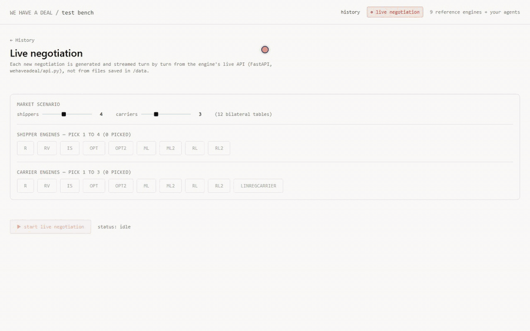

# We Have a Deal: a research toolkit for bilateral negotiation

[](https://doi.org/10.5281/zenodo.24122037)
[](LICENSE)

**We Have a Deal** is an open arena for automated freight-rate negotiation.
Shippers (buyers of transport) and carriers (sellers) negotiate many bilateral
tables in parallel under information asymmetry. Each negotiation then clears
through stable matching. You write a shipper or carrier agent, plug it in, and
benchmark it against the nine reference architectures from our paper. The
architectures span rules, search, optimization, imitation learning and
reinforcement learning.

> Before AI Agents Negotiate for Us: A Competitive Tournament of Rule-Based,
> Search, Optimization, Learned, and Language-Model Negotiators Under Scarcity.
> *(Citation below.)*

<p align="center">
  
</p>

*The local dashboard (1.5× speed): three shipper and three carrier
architectures negotiate nine tables turn by turn. One carrier, `LINREGCARRIER`,
is a community-style agent from [examples/](examples/linreg_carrier.py),
plugged in next to the references. It concedes from $3,024 to $2,732 and wins
its shipper in the final Gale–Shapley matching.
[Full-quality video (MP4)](docs/media/live-negotiation.mp4).*

**Everything in the paper is in [paper/](paper/):** the raw tournament and
LLM-study data, every figure, the analysis notebooks and the experiment
scripts. CI checks that the public package re-simulates the published results
(see [paper/README.md](paper/README.md)).

**Everything runs on your own machine.** There is no hosted service to sign up
for and nothing is sent to us. If your agent calls an LLM, it uses your own API
key or your own model server. You can then share your results on the public
leaderboard through a pull request.

## Quick start

Requires Python 3.11 or newer.

```bash
pip install torch --index-url https://download.pytorch.org/whl/cpu   # optional: small CPU-only torch
pip install -e ".[server,llm]"                                        # from a clone of this repo

wehaveadeal new-agent MyCarrier --role carrier     # creates agents/my_carrier.py, a working starter agent
wehaveadeal validate agents/my_carrier.py          # ~1 s: does it play legally?
wehaveadeal benchmark agents/my_carrier.py         # ~1 min: quick benchmark vs the 9 references
wehaveadeal benchmark agents/my_carrier.py --preset standard   # ~10 min: the leaderboard protocol
```

On Windows, keep your virtual environment at a short path (for example
`C:envs\whad`) or enable long-path support. Recent torch wheels contain file
paths longer than Windows' default 260-character limit.

The benchmark prints a summary and writes a JSON report to `results/`. For
example:

```
[balanced]  9 carriers vs 9  |  rank 4/9  |  mean outcome 41.3 [22.0, 61.8]  |  match rate 62%  |  432 days
    vs OPT2       -18.2  (n= 384, p_holm=0.041)  worse
    vs R          +55.0  (n= 384, p_holm=0.000)  better
    ...
```

## Writing an agent

An agent is one class with one method:

```python
from wehaveadeal import ACCEPT, REJECT, DecisionEngine, Move, TableState, legal_offer_range, offer

class MyCarrier(DecisionEngine):
    role = "carrier"              # or "shipper"
    engine_name = "MyCarrier"

    def next_move(self, state: TableState) -> Move:
        lo, hi = legal_offer_range(state)     # what you may offer right now
        if state.opp_last_offer is not None and state.opp_last_offer >= state.refprice_mean:
            return ACCEPT
        return offer(hi) if lo <= hi else REJECT
```

[docs/WRITING_AN_AGENT.md](docs/WRITING_AN_AGENT.md) covers what each role can
see, the rules of play, how to use the reinforcement-learning environment, and
how to wrap an LLM, and how to ship a trained model file. The
[examples/](examples/) folder has:
- a random baseline and a "market mean ± 10%" rule
- a reactive tit-for-tat agent
- a linear-regression agent with its training script
- an LLM agent that uses your own key

## The dashboard (optional, also local)

```bash
docker compose up        # then open http://localhost:3000
```

Every agent in [agents/](agents/) appears in the live view next to the
reference architectures. You can watch it negotiate turn by turn, with no
rebuild needed after you edit a file. To browse your benchmark runs in the
history view, run `wehaveadeal benchmark ... --save-rounds data`.

You can also run it without Docker: start the backend with `wehaveadeal serve`,
then run `npm install && npm run dev` inside `dashboard/`.

Security note: the backend imports and runs the Python files in `agents/`. It
binds to localhost only, and it should stay that way. Only drop in agent code
you have read.

## How the benchmark works

Your agent joins the market on its side, against the reference architectures
playing the same role. The references also fill the opposite side. Three market
regimes come from the paper:

| regime | your side | other side |
|---|---|---|
| balanced | 9 (you + 8) | 9 |
| your role scarce | 7 (you + 6) | 9 |
| other role scarce | 9 (you + 8) | 7 |

Markets and line-ups depend only on the seed, never on the entrant. This means
every agent benchmarked with the same seed faces exactly the same market days.
Results are reported per regime:
- **Mean outcome:** carrier margin over the reference price, or shipper profit.
- **Rank** among the agents on your side.
- **Paired comparisons** against each reference on the days you both played:
  bootstrap CI and a Wilcoxon signed-rank test with Holm correction.

[docs/PROTOCOL.md](docs/PROTOCOL.md) has the full details.

**Fair play is enforced, not trusted.** An illegal move, an exception, or
exceeding the per-move time limit (`--move-timeout`, default 5 s) forfeits that
table, and the report records it.

## Leaderboard

Run `--preset standard` with the default seed, then open a pull request that
adds your report to `leaderboard/submissions/`. See
[docs/LEADERBOARD.md](docs/LEADERBOARD.md). Anyone can verify an entry by
re-running it.

## Repository layout

```
wehaveadeal/            the package
  simulate.py, market.py, matching.py, scoring.py, models.py   the arena
  agents/               the 9 reference architectures (both roles), RL2Fixed (supplementary), Ollama LLM agents
  baselines_data/       trained weights for ML, ML2, RL, RL2, RL2Fixed
  ml/, rl/              imitation-learning and RL pipelines (Gymnasium env included)
  toolkit/              loader, referee (GuardedAgent), benchmark protocol
  api.py, cli.py        dashboard backend, `wehaveadeal` command
agents/                 put your agents here
examples/               example agents
dashboard/              Next.js UI
leaderboard/            submitted reports
paper/                  everything the paper reports: data, figures, notebooks, scripts
tests/                  engine tests, community-usage tests, paper reproduction checks
```

Run the tests with `pip install -e ".[dev]" && pytest`.

## Citing

Please cite the paper, and the software if you use the toolkit:

```bibtex
@unpublished{deavila2026negotiate,
  title  = {Before AI Agents Negotiate for Us: A Competitive Tournament of Rule-Based, Search, Optimization, Learned, and Language-Model Negotiators Under Scarcity},
  author = {de Avila-Armenta, Eduardo and Aquino-Ibarra, Ra{\'u}l Alejandro and
            Nicol{\'a}s-D{\'i}az, Jorge Octavio and Leon-Dominguez, Umberto},
  note   = {Manuscript},
  year   = {2026}
}

@software{wehaveadeal_toolkit,
  title  = {We Have a Deal: a research toolkit for bilateral negotiation},
  author = {de Avila-Armenta, Eduardo and Aquino-Ibarra, Ra{\'u}l Alejandro and
            Nicol{\'a}s-D{\'i}az, Jorge Octavio and Leon-Dominguez, Umberto},
  organization = {AI Lab, Freight Technologies Inc.},
  doi    = {10.5281/zenodo.24122037},
  url    = {https://github.com/AILabFr8tech/wehaveadeal},
  license = {Apache-2.0},
  year   = {2026}
}
```

GitHub's **Cite this repository** button (from [CITATION.cff](CITATION.cff))
gives the same citation in other formats.

## License

Copyright 2026 Freight Technologies, Inc. (Fr8Tech). Licensed under the
[Apache License, Version 2.0](LICENSE): code, trained weights, data and
figures. You may use, modify and redistribute it, including commercially,
provided you keep the license and the [NOTICE](NOTICE) file. The license
grants no rights to the Freight Technologies, Fr8Tech or We Have a Deal names
and marks.
